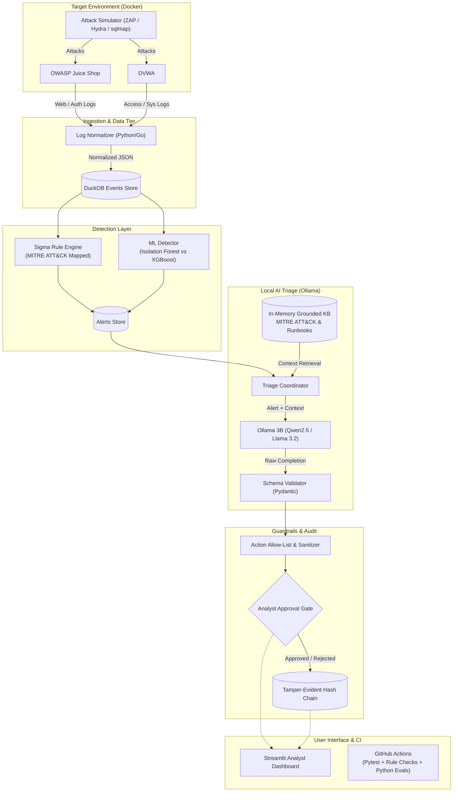

# MiniSOC-AI — System Architecture

## 1. High-Level Vision & Design Goals

MiniSOC-AI is an end-to-end, on-premise, AI-assisted Security Operations Center (SOC) pipeline designed to run on resource-constrained consumer hardware (Intel Core i5, 8 GB RAM, no dedicated GPU).

Rather than relying on closed-source cloud services (e.g. Azure Sentinel, cloud-hosted OpenAI), MiniSOC-AI proves that a modern, defensible SOC stack can be built entirely on open-source technologies with verifiable evaluation, human oversight, and cryptographic auditability.

---

## 2. Resource Budget & Memory Architecture

Target Machine: **8 GB RAM, Intel Core i5 10th Gen (4 cores / 8 threads), No GPU**.

Because running all components simultaneously would exceed 8 GB of RAM and trigger severe disk swapping, the pipeline follows strict **isolation and phase-based execution**:

| Component | Technology | Memory Footprint | Run Mode |
| :--- | :--- | :--- | :--- |
| **Host OS (Windows 10/11)** | Windows Kernel & Core Services | ~2.2 - 2.5 GB | Always On |
| **WSL2 / Docker Runtime** | Containerized Targets (Juice Shop / DVWA) | Max 5.0 GB ceiling (Capped in `.wslconfig`) | On-Demand (`docker compose --profile ...`) |
| **Ingestion & DuckDB** | Python 3.12 / DuckDB In-Process | ~250 - 500 MB | Batch / Stream Ingestion |
| **ML Engine** | scikit-learn / XGBoost (CPU) | ~300 - 600 MB | On-Demand (Training & Scoring) |
| **Local LLM** | Ollama (Qwen2.5 3B Q4_K_M or Llama 3.2 3B) | ~2.0 - 2.4 GB | On-Demand / Daemon during Triage |
| **Analyst Dashboard** | Streamlit | ~150 - 250 MB | Interactive session |

> **Operational Principle:** Vulnerable targets are started only during attack capture phases. Once logs are captured and dumped to raw storage, container instances can be stopped before initiating ML feature training or LLM triage.

---

## 3. Component Breakdown

### 3.1 Ingestion & Schema Normalization
- **Purpose:** Ingest heterogeneous log formats (Apache/Nginx web logs, JSON application logs, auth failure logs) and transform them into a unified, queryable schema.
- **Normalization Standards:** Inspired by Elastic Common Schema (ECS) and Open Cybersecurity Schema Framework (OCSF).
- **Core Normalized Fields:**
  - `@timestamp` (ISO 8601 UTC)
  - `event.category`, `event.action`, `event.outcome`
  - `source.ip`, `source.port`, `destination.ip`, `destination.port`
  - `http.request.method`, `http.request.url`, `http.response.status_code`
  - `user.name`, `user_agent.original`
  - `log.source`, `raw_event`
- **Storage:** **DuckDB**. In-process analytical database, zero daemon overhead, blazing-fast vectorized SQL queries, and zero memory persistence tax when idle.

### 3.2 Detection Engineering (Deterministic & ML)
- **Deterministic Engine:** Sigma-style rules written in YAML/Python with explicit MITRE ATT&CK technique IDs (e.g., T1110 Brute Force, T1190 Exploit Public-Facing Application, T1059 Command Injection).
- **Machine Learning Engine:**
  - **Unsupervised Anomaly Detection:** Isolation Forest on tabular event aggregations (requests per minute, distinct endpoints accessed, error code ratios).
  - **Supervised Classification:** XGBoost trained on labeled attack sequences to evaluate precision, recall, and F1 score against real-world imbalances.

### 3.3 LLM Triage & Local RAG
- **Model:** Quantized small LLM (e.g., `qwen2.5:3b` or `llama3.2:3b` via Ollama).
- **RAG Store:** Deterministic in-memory grounded retrieval indexing MITRE ATT&CK technique descriptions, detection guidance, and standard operating procedures (SOC runbooks) without external daemon overhead.
- **Output Contract:** Enforces a rigid JSON schema:
  - `incident_summary` (string)
  - `mitre_attack_technique` (ID & name)
  - `severity` (LOW, MEDIUM, HIGH, CRITICAL)
  - `confidence_score` (0.0 to 1.0)
  - `suggested_action` (one of the predefined action identifiers)
  - `reasoning` (brief evidence citing retrieved context)

### 3.4 Guardrails, Evaluation & Tamper-Evident Audit
- **Prompt Injection Defense:** Strict structural boundary tag encapsulation (`<untrusted_event_evidence>`), quarantine sanitization, attacker-controlled entity isolation (`source_ip`, `target_user`), and deterministic policy layer defense-in-depth.
- **Action Allow-List & Policy Floors:** The LLM cannot execute unbounded commands. Only allowed actions (`block_ip`, `isolate_host`, `reset_credentials`, `notify_analyst`, `dismiss_alert`) are accepted. Furthermore, the deterministic policy layer enforces severity floors (preventing downgrades of HIGH/CRITICAL alerts) and restricts alert dismissal for high-confidence threats.
- **Human-in-the-Loop:** Containment actions require explicit human analyst approval with clear target entity definitions before SOAR command execution.
- **Cryptographic Hash-Chained Audit Trail:** Every event record binds `seq`, `prev_hash`, `entry_id`, `entry_type`, `timestamp`, and `canonical_payload` via SHA-256 (with HMAC support) and cross-process file locking. Modifying metadata, tampering payloads, or tail truncating breaks chain verification mathematically.
- **Automated LLM Evaluation:** Regression testing, dynamic MITRE correctness validation, and hallucination detection powered by the native Python eval suite (`evals/run_evals.py`).

### 3.5 Analyst Dashboard
- Interactive Streamlit application displaying:
  - Incident volume, severity distributions, and MTTD/MTTR estimates.
  - Interactive MITRE ATT&CK coverage matrix.
  - Pending triage approvals with side-by-side RAG evidence inspection.
  - Tamper verification widget for the audit chain.
